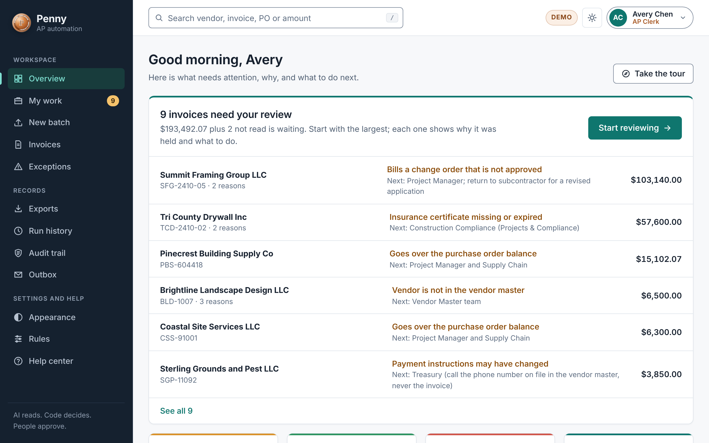
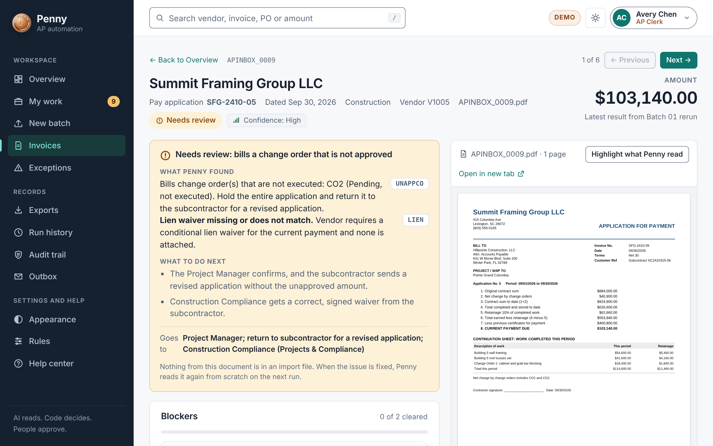
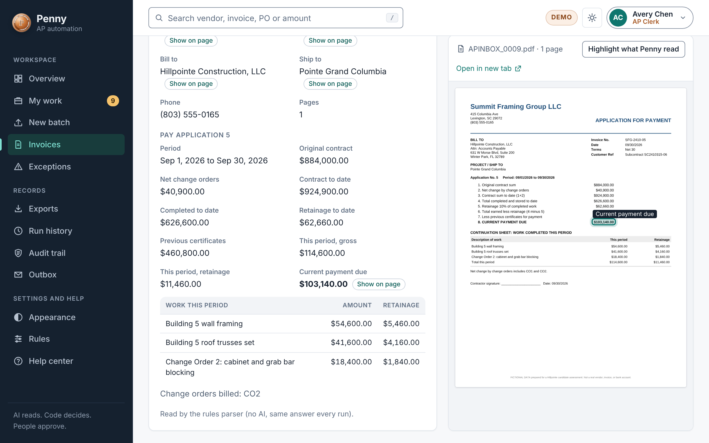
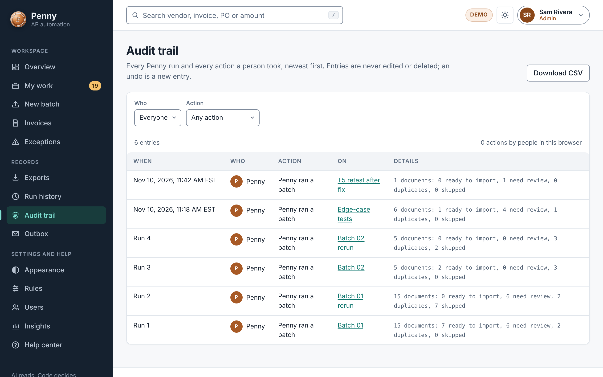
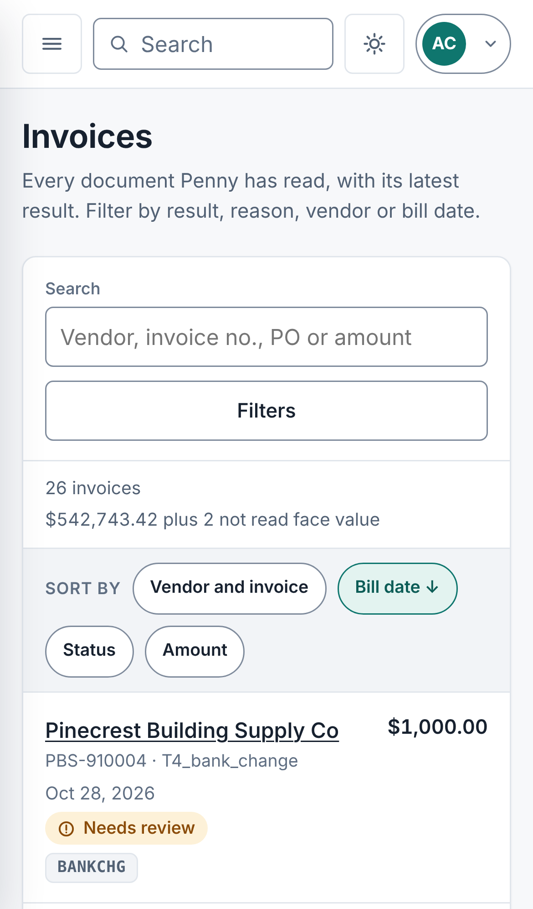
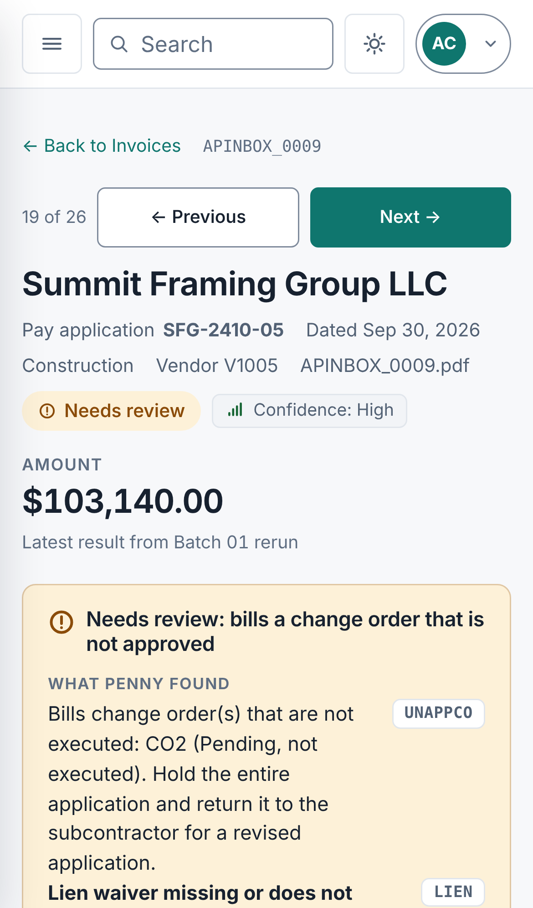

# Penny: a case study

**By Jamie Collier.** *(Added after submission, in version 2.2.0.)*

A short account of what I built, how I approached it, and the calls I had to make. It takes about four minutes to
read. Every claim here links to the page that backs it up.

---

## The problem

Accounts payable is careful work done under time pressure. Someone opens each vendor invoice, checks it against the
vendor list, the purchase order and the company's rules, decides whether it can be entered, and keys it into the
accounting system. Most invoices are fine. The few that are not are where money is lost: a bill paid twice, a
vendor's bank details quietly changed, a change order nobody approved.

The Hillpointe AP technical screen gave me 20 sample documents, a set of AP Coding Rules, and one request: turn the
inbox into a Sage Intacct import file, an exception log, and a list of approvers.

## My approach

**AI reads. Code decides. People approve.**

Reading a PDF is the only fuzzy step, so that is the only place an AI model may help, and it is off by default.
Every decision about a bill is made by plain rules in code, which give the same answer every time and can be
tested. People stay responsible for what only people should decide.

Before any code was written, I worked out the right answer for all 20 documents from the policy and saved it as an
answer key. That way the code could never grade its own work.

## What I built

**For the assessment (version 1.0):** a workflow that reads each invoice, runs up to 15 checks in order, and writes
the import file, the Entrata handoff, the exception log and the approvers. It keeps a register, so running a batch
again never enters a bill twice.

| Run | Documents | Entered | Held | Duplicate | Rows in import file |
|---|---|---|---|---|---|
| Batch 01 | 15 | 7 | 6 | 2 | 11 |
| Batch 01 again | 15 | 0 | 6 | 2 | 0 |
| Batch 02 | 5 | 2 | 0 | 3 | 2 |
| Batch 02 again | 5 | 0 | 0 | 3 | 0 |

The second and fourth rows are the point. A rerun enters nothing.

**After the assessment (versions 1.1 to 2.2):** I kept going, because a file on a disk is not something an AP team
can use. Penny is now a web app for a whole team.

* **Every hold says why,** who it goes to, and what would clear it.
* **You can check Penny's reading.** Pick a value and it is outlined on the invoice page it came from.
* **Four roles,** each able to do only its own job. Some steps need a second person.
* **An audit trail that only grows.** Nothing is edited or deleted, by anyone.
* **Rules a person can read and change,** with a preview of what a change would do to real invoices.
* **One server for a team,** with live updates, real accounts and https.
* **Built for everyone:** checked against WCAG 2.2 AA, usable by keyboard, and laid out for phones.
* **A guided tour, a setup wizard and a help center** with more than 50 articles.

The full list, version by version, is in [`CHANGELOG.md`](CHANGELOG.md) and [`SCOPE.md`](SCOPE.md).

## The hard calls

These are the decisions that shaped the project. Each one, with what I weighed, is in
[`DECISIONS.md`](DECISIONS.md).

| The call | What I chose | Why |
|---|---|---|
| Let the AI decide, or not? | It may read. It never decides. | In accounts payable a wrong answer is money leaving the company. A rule in code gives the same answer every time and can be tested. |
| What does a held bill look like? | None of it is entered. Not even the lines that look fine. | A partly entered bill is harder to find and fix than one that is clearly waiting. |
| What should the label say? | "Ready for Intacct import". Never "entered" or "paid". | A label that overstates is how a team comes to believe a bill was paid when it was not. |
| Add features, or fix the foundation? | Version 1.8.0 added no features: tests, security headers, readable code. | I did not want to build a shared server on tests that ran only on my machine. |
| Ship the next feature, or stop and review security? | I stopped. | The review found a real problem: invoices could be downloaded without signing in. I fixed it, made the fix a required update, and published what was wrong. |
| Call it production ready? | No. It is a portfolio project. | Some of what production needs I cannot do here. Saying so shows I know the difference. |

## How I worked

I directed the work and made every decision. An AI assistant (Claude Code) wrote the code and tests and often laid
out options with a recommendation. I chose, reviewed every change, and own the result. That is the same rule Penny
follows.

* **One version, one pull request,** each with its own notes and automated checks.
* **A change is proven by a test.** Penny has 125 code tests and 20 browser suites that use the app the way a person
  does, on every change.
* **The record is kept current by the project itself.** A test fails if a release is missing from the change log.
* **Limits are written down** next to the features, in every release.

## What I would do next

Penny is not production software, and [`PRODUCTION.md`](PRODUCTION.md) lists what stands between it and running a
real company's accounts payable. In the order I would do it:

1. An outside security test and a second engineer's review.
2. Sign-in with Microsoft, then Google.
3. A pilot on real invoices, beside the current process.
4. Backups, monitoring and a restore drill.
5. Connections to Intacct and Entrata, once the pilot shows the files are right.
6. An audit of the controls.

## See it

| | |
|---|---|
| **Try it in your browser** | [The live demo](https://collierjamiec.github.io/Hillpointe_AP_Submission/). Pick a demo person, then choose **Take the tour**. |
| **Run it yourself** | [`GETTING_STARTED.md`](GETTING_STARTED.md) |
| **Read the assessment as submitted** | [`00_START_HERE.md`](00_START_HERE.md) |

