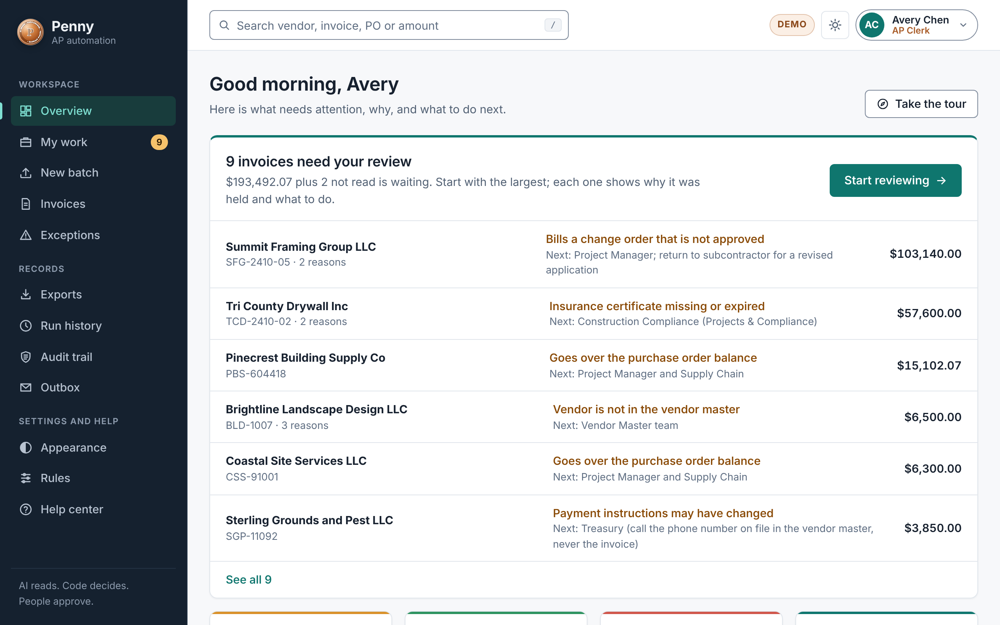
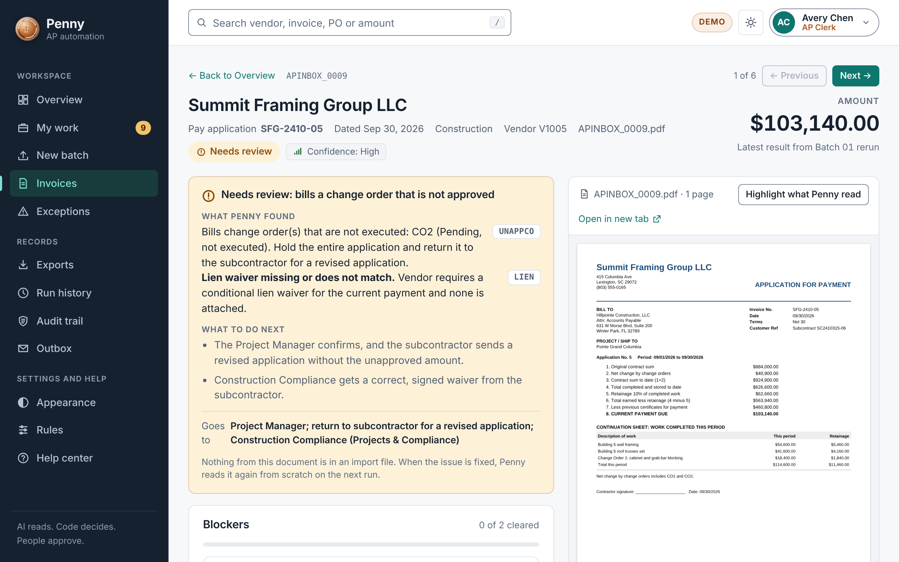
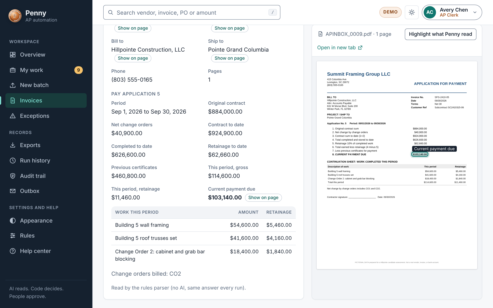
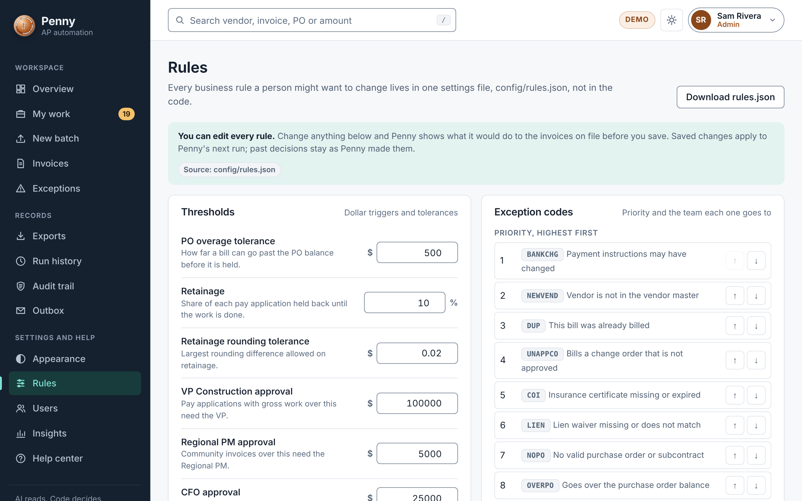
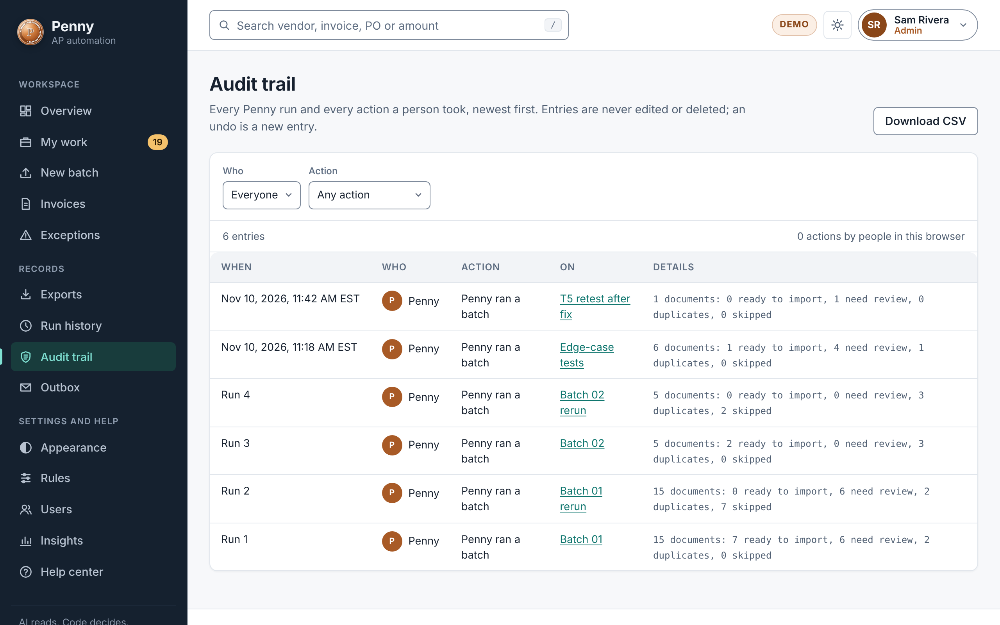
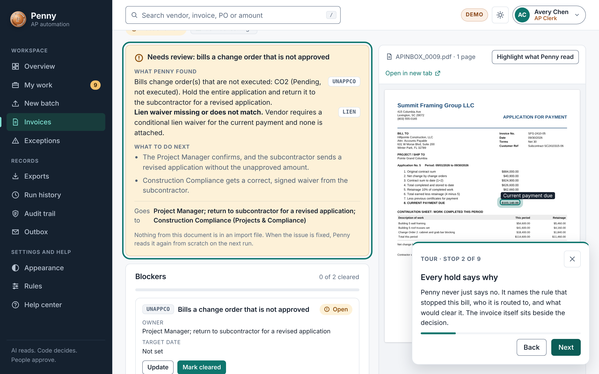
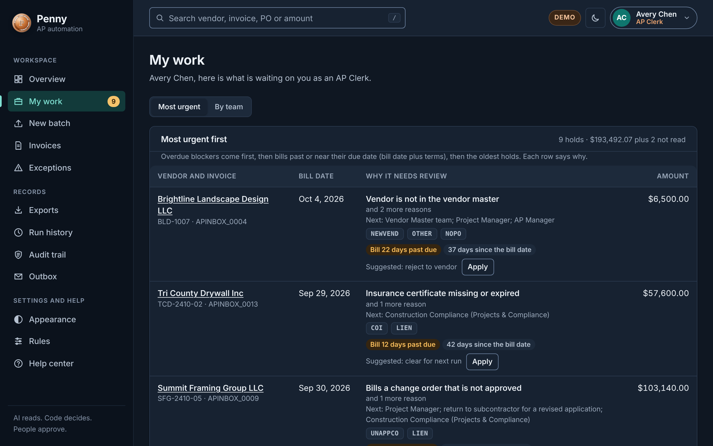

# Penny: AP invoice automation

**AI reads. Code decides. People approve.**

Penny reads vendor invoices, applies a company's accounts payable rules, and tells the AP team exactly what to enter,
what to hold, and why. It writes a ready-to-upload Sage Intacct import file, an Entrata handoff, an exception log with
a route for every hold, and the required approvers. It also keeps a register, so running a batch again never enters a
bill twice.

Penny began as my answer to the Hillpointe AP technical screen. I have kept building it since, to show how I think
about a real product.

[](https://collierjamiec.github.io/Hillpointe_AP_Submission/)

**[Open the live demo](https://collierjamiec.github.io/Hillpointe_AP_Submission/)**, pick a demo person, and choose
**Take the tour**. It takes two minutes. Or read the **[case study](CASE_STUDY.md)** (four minutes), or
**[run it yourself](GETTING_STARTED.md)** (five minutes).

> **This is a portfolio project, not production software.** It works and it is tested, and I know what stands
> between it and running a real company's accounts payable. That list, with where Penny stands on each item, is in
> [`PRODUCTION.md`](PRODUCTION.md).

| | What it is | Start here |
|---|---|---|
| **Live demo** | The web app with the example invoices, in your browser. Pick a demo role to sign in. | [collierjamiec.github.io/Hillpointe_AP_Submission](https://collierjamiec.github.io/Hillpointe_AP_Submission/) |
| **Case study** | The problem, my approach, the hard calls, and what I would do next | [`CASE_STUDY.md`](CASE_STUDY.md) |
| **Getting started** | Download it, install it and look around, step by step | [`GETTING_STARTED.md`](GETTING_STARTED.md) |
| **The assessment (v1.0)** | The package as submitted in October 2026 | [`00_START_HERE.md`](00_START_HERE.md) |
| **Built after submission (v1.1 to 2.4.0)** | A full web app for a team: roles, new batches, blockers, manual entry, user accounts, email, appearance, updates, source highlighting, export history, a watched folder, and one shared server with live updates | [`SCOPE.md`](SCOPE.md) |
| **Current version: 2.4.0** | What changed in each release, and whether it is required | [Releases](https://github.com/collierjamiec/Hillpointe_AP_Submission/releases) |
| **Why I made each choice** | Every major decision, what I weighed, and what I chose not to build | [`DECISIONS.md`](DECISIONS.md) |
| **Change log** | Every version, what changed, where the idea came from, and what was tested | [`CHANGELOG.md`](CHANGELOG.md) |
| **What production would take** | Sign-in with Microsoft and Google, an outside security test, real connections, real invoices, and more | [`PRODUCTION.md`](PRODUCTION.md) |
| **Where it is going** | The plan that led to 2.0, and what is intended next | [`ROADMAP.md`](ROADMAP.md) |
| **How it works** | Every check, rule and assumption | [`04_Workflow/README.md`](04_Workflow/README.md) |

## A look inside

| | |
|---|---|
| [](docs/screenshots/held-invoice.png) | [](docs/screenshots/source-highlighting.png) |
| **Every hold says why.** What Penny found, what to do next, and who it goes to. The invoice sits beside the decision. | **Check Penny's reading yourself.** Pick a value and it is outlined on the page it came from. |
| [](docs/screenshots/rules.png) | [](docs/screenshots/audit-trail.png) |
| **Rules a person can read.** An Admin can change one, preview what it would do to real invoices, and undo it. | **Everything is on the record.** Entries can be added. They are never edited or removed. |
| [](docs/screenshots/tour.png) | [](docs/screenshots/my-work-dark.png) |
| **A guided tour.** Nine stops on the real pages, in about two minutes. | **Light and dark,** checked against WCAG 2.2 AA, and laid out for phones. |

## What this project shows about how I work

* **I decide where AI belongs.** It reads. It never decides what happens to a bill.
* **I work out the right answer first,** so the code can never grade its own work.
* **I say what really happened, in plain words,** in labels, in limits, and in what is not done.
* **I fix the foundation and review security before adding more.**
* **I keep the record current,** and make the project check that I did.

The reasons, and what I weighed each time, are below and in [`DECISIONS.md`](DECISIONS.md).

## Decisions I made

I made every decision in this project. An AI assistant wrote the code and often laid out options; I chose, reviewed
every change, and own the result. These six shaped everything else. The full list, with what I weighed each time, is
in [`DECISIONS.md`](DECISIONS.md).

| I decided | Because |
|---|---|
| **AI may read a document. It never decides what happens to a bill.** | In accounts payable a wrong answer is money leaving the company. Rules in code give the same answer every time and can be tested. |
| **Work out the right answer before writing the code.** | So the code could never grade its own work. |
| **Say what really happened, in plain words.** "Ready for Intacct import", never "entered" or "paid". | A label that overstates is how a team comes to believe a bill was paid when it was not. |
| **Some steps need a second person, and the audit trail can only grow.** | One person checking their own work finds fewer mistakes, and a record that can be edited is not evidence. |
| **Fix the foundation and review security before adding more.** | I did not want to build a shared server on tests that ran only on my machine. The security review then found a real problem, which I fixed and published. |
| **List what is not done.** | A reviewer will find the gaps anyway. I would rather they hear them from me, with the reason. |
| **Call it a portfolio project, not production software.** | Some of what production needs I cannot do here: a company's real systems, an outside auditor, real people to test with. Saying so shows I know the difference. |

## Try it

The step-by-step version, with what to do if something goes wrong, is in [`GETTING_STARTED.md`](GETTING_STARTED.md).

The easy way: open the `04_Workflow` folder and double-click **Install Penny**. It installs Penny and opens a setup
wizard in your browser. After that, double-click **Start Penny**. The same steps by hand:

```bash
cd 04_Workflow
./penny install                                         # once
./penny setup                                           # the setup wizard, in your browser
./penny demo --package /path/to/Hillpointe_AP_Technical_Screen
./penny web-export --package /path/to/Hillpointe_AP_Technical_Screen
./penny web --package /path/to/Hillpointe_AP_Technical_Screen   # opens the web app; New batch can run invoices
```

In the web view, pick any of the four demo roles on the sign-in screen. With the demo roles, everything you do stays
in your browser.

For a team, the setup wizard turns on real accounts, where one server checks and saves everyone's work. By hand:

```bash
./penny users invite --email you@company.com --name "Your Name" --role admin   # the first Admin; then invite others in the web app
./penny email test --to you@company.com          # after setting PENNY_SMTP_* (see Help > Emailing exports)
./penny update                                    # take a new version when one is out
```

## Original scope versus what I added

* **Asked for:** an Intacct import file, an Entrata handoff, an exception log, required approvers, rerun proof, a
  one-page summary and an AI usage log.
* **Added in the submission:** an answer key written before the code, 33 tests with synthetic edge cases, a decision
  trail for every document, an Intacct pre-flight check, all rules in one settings file, and the simple `./penny`
  commands.
* **Added after submission:** bad files are held with a clear reason instead of crashing a run (v1.1), a web view
  (v1.2), and then sign-in with four roles, real actions, an audit trail, a rules editor with an impact preview, a
  redesigned interface, a help center, and an honest reason for bills in unfamiliar layouts (v1.3), then uploading
  and running new batches from the browser, suggested fixes that learn, and usage insights (v1.4), then blockers
  with owners and evidence, recheck previews, a rule simulator, manual entry with a second-person check, and a
  most-urgent-first queue (v1.5), the version on every screen with required or optional updates (v1.6.0), and user
  management, emailed exports and approvals, and appearance settings (v1.7.0), and a foundation release with browser
  tests on every pull request, a content security policy and a description on every Python function (v1.8.0), and then
  highlighting on the PDF of where each value came from, a history for each import file so nothing is imported
  twice, a watched inbox folder, paging for long lists and an accessibility pass (v1.9.0), and a layout made for
  phones (v1.9.1), and Penny for a real team: one server that checks and saves everyone's work in a database,
  live updates between teammates, and https for use over a network (v2.0.0), followed by a security review that
  found and fixed a way around sign-in (v2.0.1), and a setup wizard that installs Penny and gets it ready from
  a double-click (v2.1.0), the reasons for my decisions written into every page (v2.1.1), and an honest list of what production would
  take (v2.1.2), and a left menu that scrolls on short screens (v2.1.3), and a
  front door for the project: a guided tour in the app, a case study, a getting started guide and screenshots
  (v2.2.0), and a profile each person manages themselves, with a photo and private activity numbers (v2.3.0, a required update), and a description on every function in the web app too, with a test that keeps it that way (v2.4.0).

The full story, version by version, is in [`SCOPE.md`](SCOPE.md).

---

Built by Jamie Collier with Claude Code. Example data comes from the Hillpointe AP technical screen.
